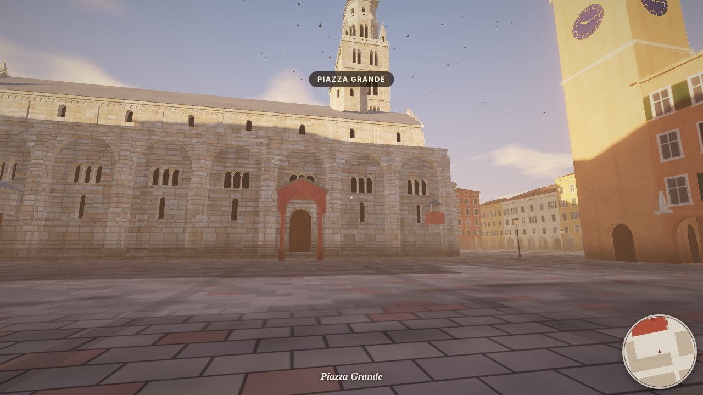
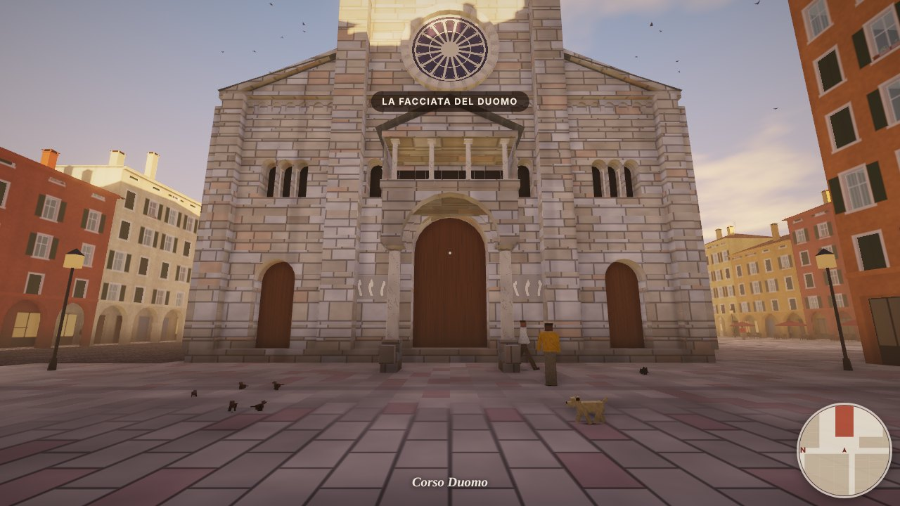
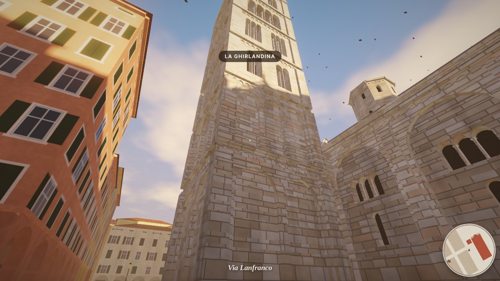
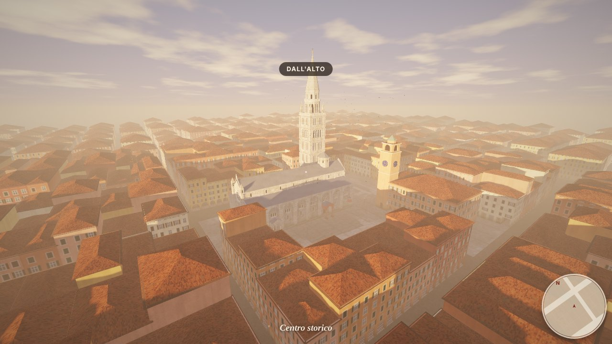
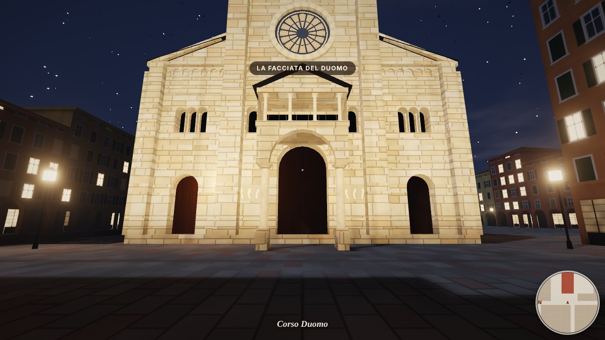

# Modena Walkaround

**Una passeggiata in 3D nel centro storico di Modena, direttamente nel browser.**

Il Duomo romanico con il protiro dei leoni e il rosone, la Ghirlandina con la sua cuspide ottagonale,
Piazza Grande con la Preda Ringadora, il Palazzo Comunale con la Torre dell'Orologio (che segna l'ora vera),
i portici di Via Emilia. Tutto è generato dal codice: niente immagini, niente modelli 3D, niente file audio.
L'intero centro sta in **un solo file HTML**.

Ispirato a [Abyssal Garden](https://github.com/Noniv/abyssal-garden).



| | |
|---|---|
|  |  |
|  |  |

## Come provarlo

1. Scarica [`index.html`](index.html) (su GitHub: apri il file e premi *Download raw file*).
2. Aprilo con doppio clic in un browser recente (Chrome, Edge, Firefox, Safari): serve **WebGL2**.
3. Premi **Entra in piazza** e cammina.

Funziona offline, non c'è niente da installare.

## Comandi

| | Tastiera e mouse |
|---|---|
| Guardarsi intorno | Mouse |
| Camminare | `W` `A` `S` `D` (o frecce) |
| Correre | `Shift` |
| Volo libero on/off | `F`, poi `E` / `Q` per salire e scendere |
| Punti di vista | `1` facciata · `2` Piazza Grande · `3` Ghirlandina · `4` absidi · `5` portici di Via Emilia · `6` dall'alto |
| Ora del giorno | `,` e `.` (mezz'ora indietro / avanti), oppure il cursore nel menu |
| Far scorrere il tempo | `T` |
| Suonare le campane | `B` |
| Mappa · Audio · Statistiche | `N` · `M` · `H` |
| Menu | `Esc` |

**Su touchscreen:** un dito sulla metà sinistra per camminare, trascina sulla metà destra per guardarti intorno.

## Cosa c'è

- **Il Duomo**: le fiancate con le grandi arcate cieche e la loggia a trifore, la Porta Regia col protiro in marmo rosso,
  la Porta dei Principi, il pulpito esterno, le tre absidi, la facciata col protiro sorretto dai leoni, i rilievi, il rosone e le edicole.
- **La Ghirlandina**: sei piani con bifore, trifore e la cella campanaria, la terrazza con i pinnacoli d'angolo,
  i due tamburi ottagonali con le balaustre (le "ghirlande") e la cuspide fino a 87 m. I due archi la collegano al Duomo.
- **Piazza Grande** con il Palazzo Comunale porticato, la Torre dell'Orologio con il quadrante che segna l'ora del tuo computer,
  la Preda Ringadora e la Bonissima sul suo mensolone.
- **Le vie intorno**: Via Lanfranco, Piazza della Torre, Corso Duomo, Via Castellaro, Piazza XX Settembre, Via Emilia con i portici,
  case intonacate nei colori di Modena con persiane verdi, botteghe, tetti di coppi.
- **Luce**: sole con ombre, cielo con nuvole, foschia, tramonto dorato; di notte lampioni, finestre accese, il Duomo illuminato, stelle e luna.
- **Animali**: passerotti che saltellano e beccano sul selciato (e volano via se ti avvicini), cani a passeggio che si fermano
  ad annusare e ti vengono a salutare scodinzolando, gatti seduti o addormentati sotto i portici, piccioni attorno alla Ghirlandina.
  E da qualche parte, in un posto diverso ogni volta, **una foca**. Una sola. Trovala.
- **Suoni** sintetizzati dal vivo: il brusio della città, i piccioni, i passi sulla pietra e le campane della Ghirlandina.

È una ricostruzione libera: i monumenti sono modellati con cura, gli isolati intorno seguono solo a grandi linee
la pianta reale.

## Come è fatto

- WebGL2 puro, nessuna libreria 3D. Tutta la città è un'unica mesh costruita all'avvio con primitive procedurali
  (archi, colonne, tetti a padiglione, prismi ottagonali...).
- Le superfici sono texture procedurali calcolate nello shader: conci di pietra, intonaco con finestre e persiane,
  coppi, sampietrini, lastre della piazza, marmo, il rosone e il quadrante dell'orologio.
- Ombre del sole (shadow map ricalcolata solo quando il sole si muove), occlusione ambientale dalle sagome degli edifici,
  HDR con bloom e tone mapping filmico, risoluzione adattiva per restare fluido.

## Modificarlo

Il codice leggibile è nella cartella [`source`](source):

| File | Contenuto |
|---|---|
| [`source/src/city.js`](source/src/city.js) | La città: Duomo, Ghirlandina, Palazzo Comunale, isolati, nomi delle vie, punti di vista |
| [`source/src/geom.js`](source/src/geom.js) | Le primitive geometriche (muri con archi, colonne, tetti...) |
| [`source/src/shaders.js`](source/src/shaders.js) | I materiali procedurali, la luce, il cielo e il post-processing |
| [`source/src/main.js`](source/src/main.js) | Renderer, camera, comandi, ciclo giorno/notte, piccioni, mappa |
| [`source/src/audio.js`](source/src/audio.js) | I suoni |

Per ricostruire `index.html` serve [Node.js](https://nodejs.org) 18+:

```bash
cd source
npm install
npm run build          # minificato
npm run build:readable # leggibile, senza dipendenze
```
